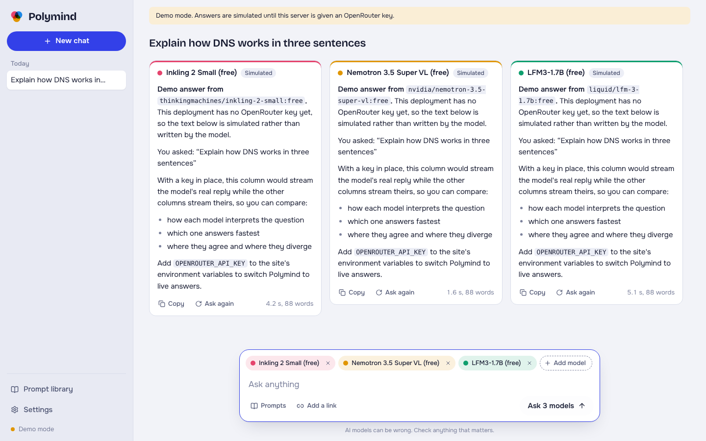
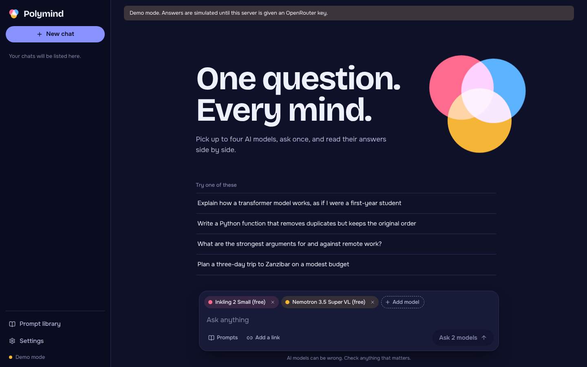
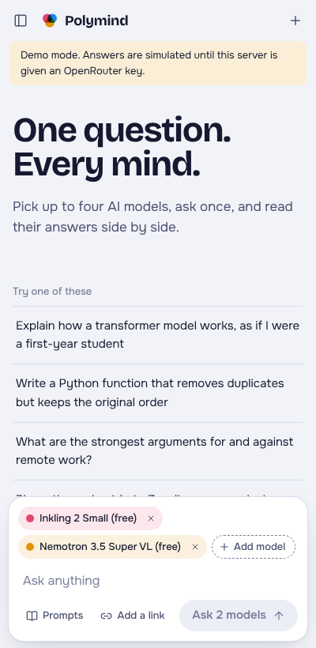
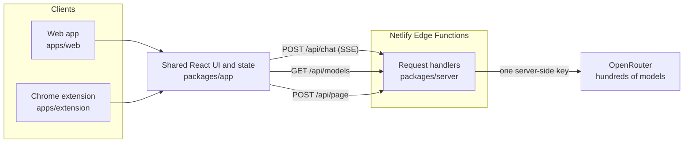

# Polymind

**One question. Every mind.** Polymind sends a single prompt to several AI models at once and lines their answers up side by side. It ships as a web app and as a Chrome side panel, built from one shared codebase, with access to the hundreds of models available through [OpenRouter](https://openrouter.ai).

Visitors never enter an API key. A small server function holds one key and decides which models the public may use.



| Dark theme | Chrome side panel |
| --- | --- |
|  |  |

## What it does

- **Side-by-side comparison.** Pick up to four models. Each answer streams into its own column with its own colour, response time and word count, so differences are easy to spot.
- **Chat with a page.** In the extension, one click reads the tab you are on. In the web app, paste a link and the server fetches the readable text. Every selected model can then answer questions about it.
- **Selected-text actions.** In the extension, select text on any site to explain, summarise, rewrite or translate it. A right-click menu entry does the same.
- **Popular models first.** The picker opens on the best-known families (GPT, Claude, Gemini, Grok, DeepSeek and more), plus "Polymind Auto", which lets OpenRouter choose a model for each prompt.
- **A free daily allowance.** In allowance mode every visitor gets a few answers from paid models each day, counted per visitor and capped across the site, so a public demo cannot drain the owner's credits.
- **Prompt library.** Reusable prompts with fill-in blanks written as `{{topic}}`. Six are built in and you can save your own.
- **Private by default.** Chats and prompts live in the browser's local storage. The server stores nothing.
- **Light and dark themes**, keyboard-accessible dialogs, reduced-motion support, and a layout that works from a 360 px side panel to a wide desktop.

## How it is built



| Part | Role |
| --- | --- |
| `packages/app` | The whole interface: React 19, TypeScript, Zustand for state, hand-written CSS with design tokens. Knows nothing about where it runs. |
| `packages/server` | Three request handlers written against web-standard `Request`/`Response`, so the same code runs on Netlify's edge, in Node and in tests. No dependencies. |
| `apps/web` | Thin shell that mounts the shared UI. Its Vite config also serves the API locally by calling the same handlers. |
| `apps/extension` | Manifest V3 extension: side panel, service worker and a dependency-free content script. |
| `netlify/edge-functions` | Three-line wrappers that expose the handlers and declare rate limits. |

A few decisions worth knowing about:

- **A platform interface instead of `if (isExtension)`.** The UI receives a small `Platform` object (`readActiveTab`, `onQuickAction`, `apiBase`). The web app and the extension each supply their own, which keeps browser-extension APIs out of the shared code.
- **Streaming end to end.** The edge function pipes OpenRouter's Server-Sent Events straight through. The client parses them incrementally and batches tokens once per animation frame, so four simultaneous streams stay smooth.
- **Each model keeps its own thread.** On a follow-up question a model is shown its own earlier answers, not another model's.
- **Minimal extension permissions.** `sidePanel`, `storage` and `contextMenus` only. The side panel asks the content script for page text when you click, so no broad host permission or `tabs` permission is requested.

## Run it locally

Requires Node 20 or newer.

```bash
git clone https://github.com/NdelilioBenjie/polymind.git
cd polymind
npm install
cp .env.example .env      # optional: add your OpenRouter key
npm run dev               # http://localhost:5173
```

Without a key Polymind runs in **demo mode**: the full interface works and answers are clearly labelled simulated text. Add `OPENROUTER_API_KEY` to `.env` and restart for real answers.

```bash
npm test                  # unit tests
npm run typecheck
npm run build:all         # web app and extension
```

## Deploy to Netlify

1. Push this repository to GitHub and choose **Add new site, Import an existing project** in Netlify. `netlify.toml` already holds the build settings.
2. In **Site configuration, Environment variables**, add the settings below.
3. Deploy. The site is live at `https://<your-site>.netlify.app`.

| Variable | Default | Meaning |
| --- | --- | --- |
| `OPENROUTER_API_KEY` | none | Your OpenRouter key. Without it the site runs in demo mode. |
| `POLYMIND_MODEL_ACCESS` | `free` | `free`: zero-cost models only. `allowance`: paid models too, with a small daily allowance per visitor. `all`: everything, unlimited, on your credits. |
| `POLYMIND_DAILY_PREMIUM` | `5` | Allowance mode: paid answers each visitor gets per day. |
| `POLYMIND_DAILY_PREMIUM_TOTAL` | `200` | Allowance mode: paid answers the whole site serves per day. |
| `POLYMIND_PREMIUM_PRICE_CEILING` | `15` | Allowance mode: paid models whose output price exceeds this many dollars per million tokens stay locked. |
| `POLYMIND_MAX_OUTPUT_TOKENS` | `2048` | Cap on the length of a single answer. |
| `POLYMIND_ALLOWED_ORIGINS` | none | Extra browser origins allowed to call the API, comma-separated. |
| `POLYMIND_USE_NETLIFY_GATEWAY` | `false` | Netlify's AI Gateway injects its own OpenRouter credentials when you set no key, billed to your Netlify credits. Polymind ignores them unless this is `true`. |

### Protecting your key

Because the key is yours, the public site is locked down by default:

- Only free models are usable until you set `POLYMIND_MODEL_ACCESS=all`. Locked models still appear in the picker, marked as unavailable.
- Netlify enforces per-visitor rate limits before the functions run (40 chat requests a minute, declared in `netlify/edge-functions`).
- Requests are validated and size-capped, and answer length is capped server-side.
- Before switching to `all`, set a credit limit on the key in your OpenRouter dashboard. That limit is the real ceiling on what a stranger can spend.

## Install the extension

```bash
cp apps/extension/.env.example apps/extension/.env
# set VITE_POLYMIND_API to your deployed site, e.g. https://polymind.netlify.app
npm run build:extension
```

Open `chrome://extensions`, turn on **Developer mode**, choose **Load unpacked** and select `apps/extension/dist`. Click the Polymind icon, or press `Ctrl+Shift+Y` (`Cmd+Shift+Y` on a Mac), to open the side panel. The server address can also be changed later in the panel's settings.

Tabs that were already open when you installed the extension need one reload before Polymind can read them.

## Project layout

```
polymind/
├── apps/
│   ├── web/                 Web app shell and local API plugin
│   └── extension/           MV3 side panel, service worker, content script
├── packages/
│   ├── app/                 Shared UI, state and API client
│   └── server/              Chat, catalogue and page-reader handlers
├── netlify/edge-functions/  Deploy wrappers with rate limits
├── tests/                   Vitest unit tests
└── scripts/make-icons.py    Renders the extension icons
```

## Known limits

- Selected-text actions exist only in the extension. The web app cannot see other sites.
- The page reader extracts text with a simple HTML stripper, so pages that render entirely in JavaScript come back thin. The extension reads the live page and does not have this problem.
- Conversations are text only. Image input is not wired up yet.
- There are no user accounts, so limits are per IP address.

## Roadmap

- Accounts and per-user quotas
- Image and file input for models that accept them
- A "judge" step that asks one model to summarise where the others agree and differ
- Firefox and Edge builds

## Licence

MIT. Built by [Benjamen Ayo](https://github.com/NdelilioBenjie).
